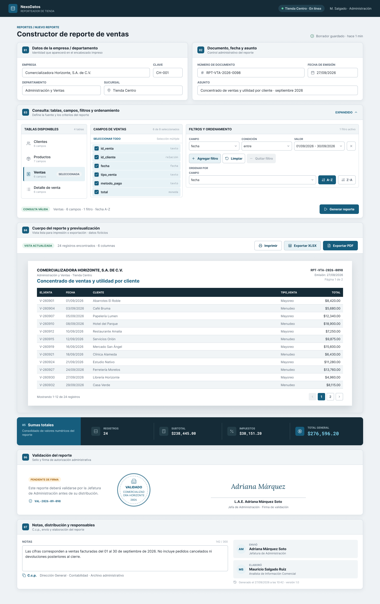

# Reporteador de tienda — Constructor de reporte de ventas

Documentación de las secciones que conforman el diseño **"Reporteador de tienda"** (frame de 1440 × 2287 px) del archivo de Figma *Sin título*.

La pantalla pertenece al producto **NexoDatos**, módulo *Reporteador de tienda*. Permite armar un reporte de ventas a partir de tablas de la base de datos, previsualizarlo como documento imprimible, revisar sus totales, validarlo con sello y firma, y registrar notas y responsables.

---

## Estructura general

| # | Sección | Propósito |
|---|---------|-----------|
| — | Barra de aplicación | Marca, estado de conexión y usuario activo |
| — | Encabezado de página | Ruta de navegación, título y estado del borrador |
| 01 | Datos de la empresa / departamento | Identidad que aparece en el encabezado impreso |
| 02 | Documento, fecha y asunto | Control administrativo del reporte |
| 03 | Consulta: tablas, campos, filtros y ordenamiento | Definición de la fuente y los criterios del reporte |
| 04 | Cuerpo del reporte y previsualización | Vista lista para imprimir o exportar |
| 05 | Sumas totales | Consolidado de los valores numéricos |
| 06 | Validación del reporte | Sello y firma de autorización |
| 07 | Notas, distribución y responsables | C.c.p., envío y elaboración del reporte |

---

## Barra de aplicación

Franja superior oscura fija de 64 px de alto.

- **Marca:** ícono de base de datos con el nombre **NexoDatos** y el módulo *Reporteador de tienda*.
- **Estado de conexión:** indicador verde con el texto *Tienda Centro · En línea*, que muestra a qué sucursal está conectada la herramienta.
- **Usuario:** *M. Salgado · Administración*, la persona que tiene la sesión abierta y su área.

## Encabezado de página

- **Ruta (breadcrumb):** *Reportes / Nuevo reporte*.
- **Título:** *Constructor de reporte de ventas*.
- **Estado del borrador:** *Borrador guardado · hace 1 min*, con ícono de verificación. Indica que el trabajo se guarda automáticamente.

---

## 01 · Datos de la empresa / departamento

Tarjeta de la columna izquierda. Captura la identidad que se imprimirá en el encabezado del reporte.

- **Empresa:** Comercializadora Horizonte, S.A. de C.V.
- **Clave:** CH-001
- **Departamento:** Administración y Ventas
- **Sucursal:** Tienda Centro (con ícono de ubicación)

## 02 · Documento, fecha y asunto

Tarjeta de la columna derecha, junto a la sección 01. Contiene los datos de control administrativo del documento.

- **Número de documento:** RPT-VTA-2026-0098 (ícono `#`)
- **Fecha de emisión:** 27/09/2026 (ícono de calendario)
- **Asunto:** Concentrado de ventas y utilidad por cliente · septiembre 2026

---

## 03 · Consulta: tablas, campos, filtros y ordenamiento

Sección principal de construcción del reporte. Es colapsable y aparece **Expandida**. Se divide en tres columnas y una barra inferior.

### Tablas disponibles (4 tablas)
Lista de las tablas de la base de datos que se pueden usar como fuente. Cada una indica su número de campos:
- Clientes (6 campos)
- Productos (7 campos)
- **Ventas (6 campos) — Seleccionada**
- Detalle de venta (6 campos)

### Campos de ventas (6 de 8 seleccionados)
Listado de casillas con los campos de la tabla elegida y su tipo de dato. Incluye la acción **Seleccionar todo** y la nota *Selección múltiple*.
- `id_venta` (texto), `id_cliente` (relación), `fecha` (fecha), `tipo_venta` (texto), `metodo_pago` (texto), `total` (moneda)

### Filtros y ordenamiento (1 filtro activo)
- **Filtro activo:** tres selectores (*Campo* = fecha, *Condición* = entre, *Valor* = 01/09/2026 – 30/09/2026) y un botón para quitar el filtro (✕).
- **Acciones de filtro:** *Agregar filtro*, *Limpiar* y *Quitar filtro* (este último aparece deshabilitado).
- **Ordenar por:** selector de campo (*fecha*) con botones de dirección **A-Z** (activo) y **Z-A**.

### Resumen y generación
- Etiqueta **Consulta válida** con el resumen *Ventas · 6 campos · 1 filtro · fecha A-Z*.
- Botón principal **Generar reporte**, que ejecuta la consulta.

---

## 04 · Cuerpo del reporte y previsualización

Muestra el resultado de la consulta como una hoja lista para imprimir o exportar. Usa datos ficticios.

### Herramientas de previsualización
- Estado **Vista actualizada**, con el detalle *24 registros encontrados · 6 columnas*.
- Acciones de salida: **Imprimir**, **Exportar XLSX** y **Exportar PDF** (acción principal).

### Hoja del reporte (lienzo de impresión)
- **Encabezado impreso:** nombre de la empresa, departamento y sucursal, y el título *Concentrado de ventas y utilidad por cliente*. A la derecha aparece el folio con el número de documento, la fecha de emisión y *Página 1 de 2*. Estos datos vienen de las secciones 01 y 02.
- **Tabla de resultados:** columnas `ID_VENTA`, `FECHA`, `CLIENTE`, `TIPO_VENTA` y `TOTAL`, con 12 registros visibles (p. ej. *V-260901 · 01/09/2026 · Abarrotes El Roble · Mayoreo · $8,420.00*). El encabezado de la tabla es oscuro y las filas son alternas.
- **Paginación:** *Mostrando 1-12 de 24 registros* y controles de página (anterior deshabilitado, 1 seleccionada, 2 y siguiente).

---

## 05 · Sumas totales

Banda oscura de alto contraste con el consolidado numérico del reporte. A la izquierda va el identificador de la sección y a la derecha cuatro indicadores con ícono:

| Indicador | Valor |
|-----------|-------|
| Registros | 24 |
| Subtotal | $238,445.00 |
| Impuestos | $38,151.20 |
| **Total general** | **$276,596.20** (destacado) |

---

## 06 · Validación del reporte

Bloque de autorización administrativa antes de distribuir el reporte.

- **Estatus de validación:** etiqueta **Pendiente de firma**, la instrucción *"Este reporte deberá validarse por la Jefatura de Administración antes de su distribución"* y el folio de control **VAL-2026-09-098**.
- **Sello institucional:** sello circular doble con ícono de edificio, el texto *Validado*, *Comercializadora Horizonte* y el año *2026*.
- **Firma de autorización:** firma manuscrita sobre una línea, con el nombre **L.A.E. Adriana Márquez Soto** y el cargo *Jefa de Administración · Firma de validación*.

---

## 07 · Notas, distribución y responsables

Cierre del documento con observaciones, destinatarios y trazabilidad.

- **Notas:** área de texto con contador de caracteres (*142 / 300*). Contenido de ejemplo: *"Las cifras corresponden a ventas facturadas del 01 al 30 de septiembre de 2026. No incluye pedidos cancelados ni devoluciones posteriores al cierre."*
- **C.c.p. (copia para):** Dirección General · Contabilidad · Archivo administrativo.
- **Responsables:** tarjetas con iniciales:
  - **Envió:** Adriana Márquez Soto — Jefatura de Administración (AM)
  - **Elaboró:** Mauricio Salgado Ruiz — Analista de Información Comercial (MS)
- **Trazabilidad:** *Generado el 27/09/2026 a las 10:42 · versión 1.0*.

---

## Flujo de uso sugerido

1. Llenar la identidad de la empresa (01) y los datos del documento (02).
2. Construir la consulta (03): elegir la tabla y los campos, y aplicar filtros y orden.
3. Pulsar **Generar reporte** y revisar la previsualización (04).
4. Verificar los totales (05).
5. Obtener el sello y la firma de validación (06).
6. Agregar notas y destinatarios (07), y luego imprimir o exportar a XLSX o PDF.
